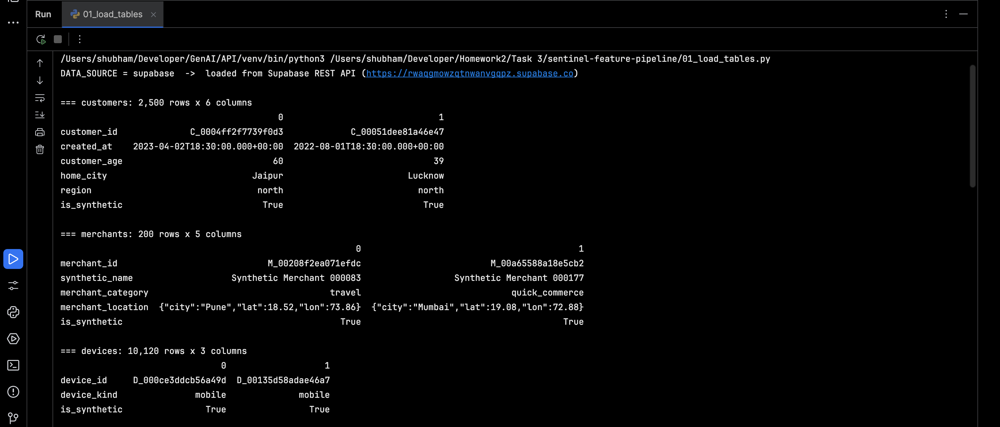
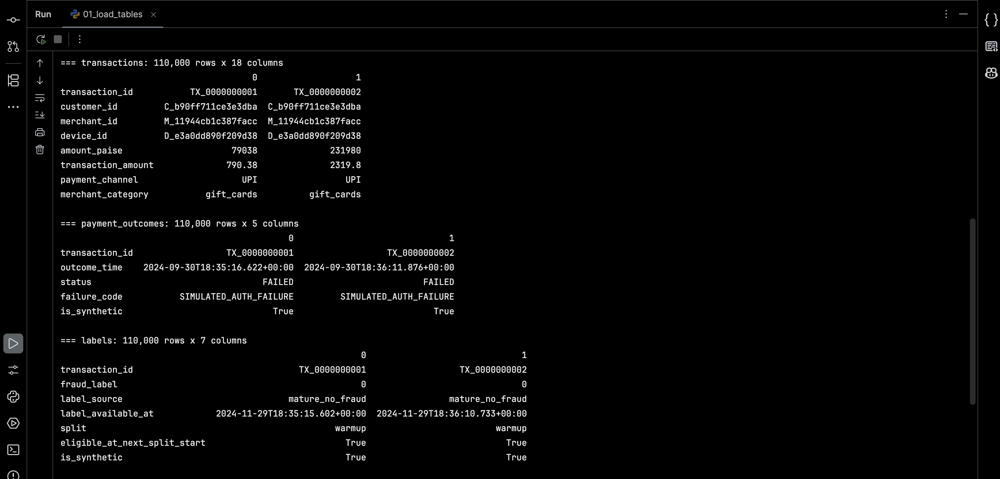
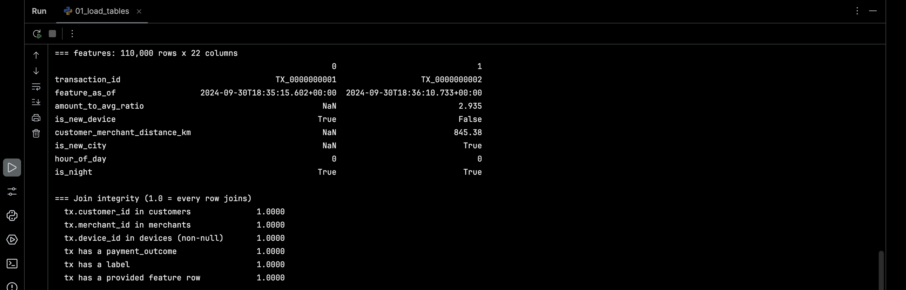
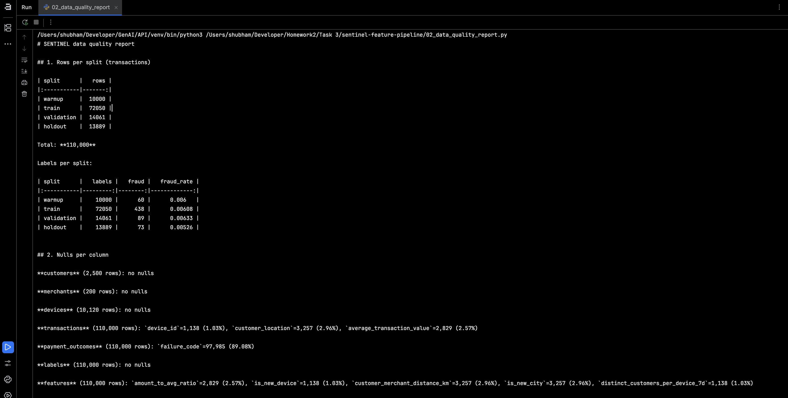
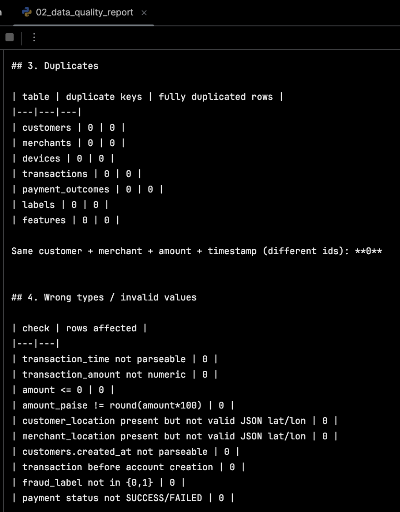
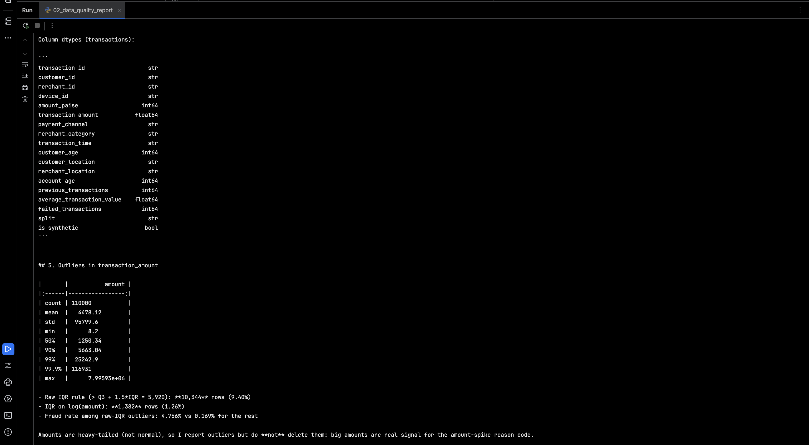
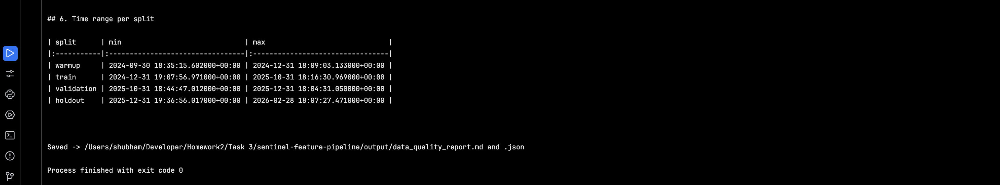
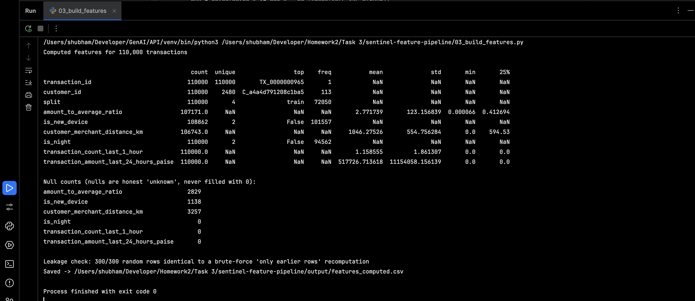
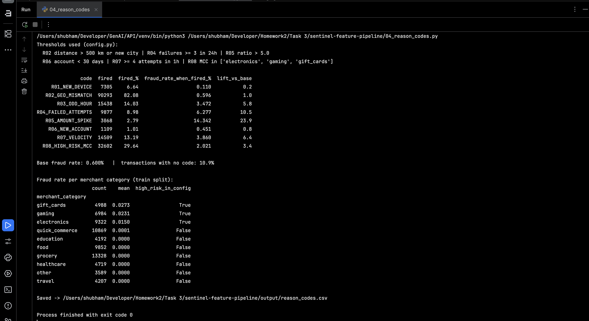
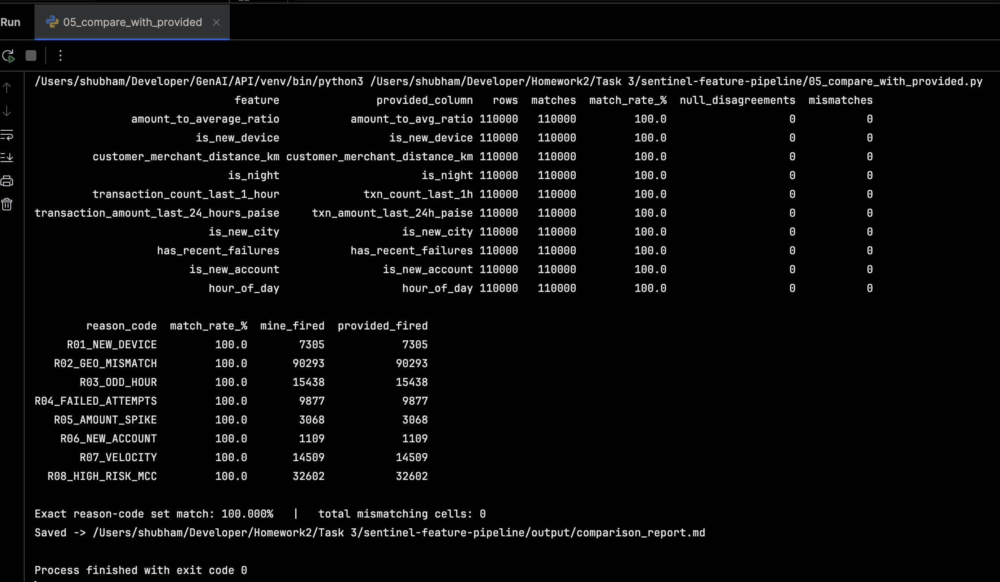

# SENTINEL data processing and feature pipeline

Pandas pipeline over the SENTINEL fraud data: load 6 tables (+ provided features) **from Supabase over the REST API**, write a data-quality report, compute 6 leakage-free
features, assign reason codes R01-R08, and compare everything with the instructor's provided `features` table.

**Result on all 110,000 transactions:** every feature matches the provided table 100.000%, and the reason-code set is identical on 100.000% of rows.

## 1. Setup (Mac / Linux)

```bash
git clone https://github.com/shubhamthanage/sentinel-feature-pipeline.git
cd sentinel-feature-pipeline
python3 -m venv .venv && source .venv/bin/activate
pip install -r requirements.txt
cp .env.example .env
```

`requirements.txt`
```
pandas>=2.1
numpy>=1.26
python-dotenv>=1.0
tabulate>=0.9
supabase>=2.0
```

`.env.example` (copy it to `.env` and fill in your own project; `.env` is git-ignored)
```
DATA_SOURCE=supabase                       # or "csv" to read the local export offline
SUPABASE_URL=https://your-project.supabase.co
SUPABASE_KEY=sb_publishable_xxx            # publishable/anon key, read-only is enough
DATA_DIR=supabase_db_kit/data/tables       # only used when DATA_SOURCE=csv
```

### Loading route
* **Supabase (default).** The tables are first ingested into your Supabase project with the instructor kit
  (`python supabase_db_kit/ingest.py all`). `sentinel_lib.load_all()` then reads all 7 tables
  (`customers, merchants, devices, transactions, payment_outcomes, labels, features`) through the Supabase REST API
  with the `supabase` Python client: an exact row count first, then pages of 1,000 rows ordered by primary key
  (`.order(pk).range(a, b)`), 8 pages in parallel, one client per thread, retry with back-off on network errors,
  and a final check that the number of rows received equals the count.
  API rows are normalised to the export's format (jsonb -> JSON text, timestamps -> `...ss.mmm+00:00`), so the
  Supabase route returns **exactly the same DataFrames** as the CSV export (verified on all 7 tables).
* **CSV (offline fallback).** `DATA_SOURCE=csv` reads the gzipped CSV shards in `DATA_DIR`.

Expected layout for the CSV route / the ingest kit:
```
sentinel-feature-pipeline/            <- this repo
  supabase_db_kit/data/tables/{customers,merchants,devices,transactions,payment_outcomes,labels,features}/...
  01_load_tables.py ... 05_compare_with_provided.py
```

## 2. How to run

```bash
python 01_load_tables.py            # load from Supabase + join-integrity check
python 02_data_quality_report.py    # -> output/data_quality_report.md/.json
python 03_build_features.py         # 6 features + no-leakage proof (300 rows recomputed by brute force)
python 04_reason_codes.py           # R01-R08 + fraud lift per code
python 05_compare_with_provided.py  # -> output/comparison_report.md
```
Each step loads the tables from Supabase (about 40 s over the API); with `DATA_SOURCE=csv` the whole thing takes about 40 seconds.

## 3. What is in the repo

| File | Purpose |
|---|---|
| `config.py` | settings + **every threshold** (windows, 500 km, 5x, 4/hour, high-risk MCCs) |
| `sentinel_lib.py` | loading (Supabase REST API or CSV), haversine, rolling-window features, reason codes |
| `01`-`05_*.py` | the five steps above |
| `output/` | generated reports (`data_quality_report.md`, `comparison_report.md`, `feature_match_rates.csv`, `reason_code_summary.csv`) |
| `screenshots/` | proof of each run (multi-part outputs numbered 1, 2, 3; see section 8) |

## 4. Feature definitions (no future leakage)

All windows are **closed on the left**, so the current transaction is never in its own history. Rows are sorted by customer, time, transaction_id.
History = every earlier authorisation attempt of the customer, declines included, across all splits (warmup supplies history for train).
"Earlier" means a **strictly earlier timestamp**: another transaction at the same instant is never history. `is_new_device` and `is_new_city` use `_prev_time_strict` (ties collapsed before shifting) instead of a row-based `shift(1)`, which would leak a same-timestamp row.

| Feature | Definition |
|---|---|
| `amount_to_average_ratio` | amount / mean amount of the customer's attempts in the previous 90 days; null if no history |
| `is_new_device` | device not used by this customer in the previous 90 days; null if device missing |
| `customer_merchant_distance_km` | haversine (R = 6371 km) between customer and merchant lat/lon; null if location missing |
| `is_night` | hour in IST (UTC+5:30) is 00:00 inclusive to 05:00 exclusive |
| `transaction_count_last_1_hour` | earlier attempts by this customer in the last 1 h |
| `transaction_amount_last_24_hours` | sum of earlier attempt amounts (paise) in the last 24 h |

Support features for reason codes: `is_new_city`, `has_recent_failures` (>= 3 FAILED outcomes already received in 24 h), `is_new_account` (< 30 days).

Leakage proof (step 3): 300 random rows are recomputed with a slow brute-force filter `t < current_time`; all 300 are identical to the fast pandas version (ratio, 1 h count, 24 h amount and `is_new_device`). A synthetic test then puts two transactions on the same device at the same instant and asserts both get `is_new_device = True`.

## 5. Reason codes and thresholds

| Code | Rule | Fires on | Fraud rate when fired (base 0.60%) |
|---|---|---|---|
| R01_NEW_DEVICE | `is_new_device` | 6.6% | 0.11% |
| R02_GEO_MISMATCH | new city **or** distance > 500 km | 82.1% | 0.60% |
| R03_ODD_HOUR | `is_night` | 14.0% | 3.47% |
| R04_FAILED_ATTEMPTS | >= 3 failed outcomes in 24 h | 9.0% | 6.28% |
| R05_AMOUNT_SPIKE | ratio > 5 | 2.8% | 14.34% |
| R06_NEW_ACCOUNT | account age < 30 days | 1.0% | 0.45% |
| R07_VELOCITY | >= 4 attempts in 1 h | 13.2% | 3.86% |
| R08_HIGH_RISK_MCC | electronics, gaming, gift_cards | 29.6% | 2.02% |

How the thresholds were fixed: R04 (3), R06 (30 days) and the night window are written in the client's `feature_catalogue.json`.
R02 (500 km), R05 (5x), R07 (4/hour) and the R08 category list are not written there, so I read them off the provided `reason_codes`
column (smallest value where the code is on / largest where it is off: ratio 4.998 off vs 5.004 on; count 3 off vs 4 on; distance 470 km off).
R08 is category based; train labels agree (gift_cards 2.7%, gaming 2.3%, electronics 1.5% fraud, all other categories ~0%).

Honest observations: R02 fires on 82% of rows and R01 / R06 are not above base fraud rate here, so on this synthetic data they are weak signals; R05, R04, R07 and R03 carry the lift.

## 6. Data quality summary (details in `output/data_quality_report.md`)

* Rows per split: warmup 10,000 / train 72,050 / validation 14,061 / holdout 13,889 (total 110,000).
* Nulls: `device_id` 1.03%, `customer_location` 2.96%, `average_transaction_value` 2.57%; these stay null, they are never filled with 0.
* Duplicates: 0 duplicate keys, 0 duplicate rows. Types: all timestamps and JSON locations parse; `amount_paise` always equals `amount x 100`.
* Amount outliers: heavy tail (median 1,250, p99.9 116,931, max 7,995,930). 9.4% rows above the raw IQR fence; fraud rate 4.76% among them vs 0.17% for the rest, so they are kept, not deleted.

## 7. Comparison with the provided features table

Full table: `output/comparison_report.md`. Every compared feature is **110,000 / 110,000 = 100.000%**, null disagreements 0.
Differences I hit while building and how each was explained and fixed:

| What went wrong first | Cause | Fix |
|---|---|---|
| ratio matched only 63.2% | I averaged only SUCCESS payments; client averages all attempts | use all attempts |
| tiny float differences | provided table rounds (4 dp ratio, 2 dp km) | tolerance 1e-4 / 0.011 |
| first transaction of a customer | no history, ratio undefined | stay null on both sides |
| failures | outcomes that arrive after the transaction must not count | only `outcome_time <= transaction_time` |
| same-second rows | a row could see itself | `closed="left"` + deterministic sort |

## 8. Screenshots (proof of every run)

All five scripts were run in PyCharm and each finished with `Process finished with exit code 0`.
Some outputs were longer than one screen, so they are split into numbered parts with the same base name
(`01_load.png`, `01_load1.png`, `01_load2.png`, ...). Read them in that order.

| Step | Script | Screenshot(s) | What it proves |
|---|---|---|---|
| 1 | `01_load_tables.py` | `01_load.png` (part 1), `01_load1.png` (part 2), `01_load2.png` (part 3) | `DATA_SOURCE = supabase`; all 7 tables load from the Supabase API with row/column counts (customers 2,500, merchants 200, devices 10,120, transactions / payment_outcomes / labels / features 110,000 each); join integrity = 1.0000 for every join |
| 2 | `02_data_quality_report.py` | `02_quality_report.png` (part 1), `02_quality_report1.png` (part 2), `02_quality_report2.png` (part 3), `02_quality_report3.png` (part 4) | 1 rows + fraud rate per split, 2 nulls per column; 3 duplicates (all 0), 4 wrong types / invalid values (all 0); column dtypes, 5 amount outliers (IQR, kept not deleted); 6 time range per split + report saved |
| 3 | `03_build_features.py` | `03_features_leakage_check.png` | 6 features computed for 110,000 rows, null counts (never filled with 0), **leakage check 300/300 identical** to brute-force "only earlier rows" |
| 4 | `04_reason_codes.py` | `04_reason_codes.png` | thresholds used, R01-R08 fire counts, fraud rate and lift vs 0.600% base, fraud rate per merchant category |
| 5 | `05_compare_with_provided.py` | `05_comparison.png` | every feature 110,000 / 110,000 = **100.0%**, 0 null disagreements, every reason code 100.0%, exact reason-code set match 100.000%, 0 mismatching cells |

### Step 1 - load tables + join integrity




### Step 2 - data quality report





### Step 3 - features + leakage check


### Step 4 - reason codes


### Step 5 - comparison with provided features table


## 9. Limits

Synthetic data only. Thresholds are the client's rules recovered from the provided table, not tuned by me. Match rate of 100% proves I reproduced the client's definitions, not that the rules are good detectors.
